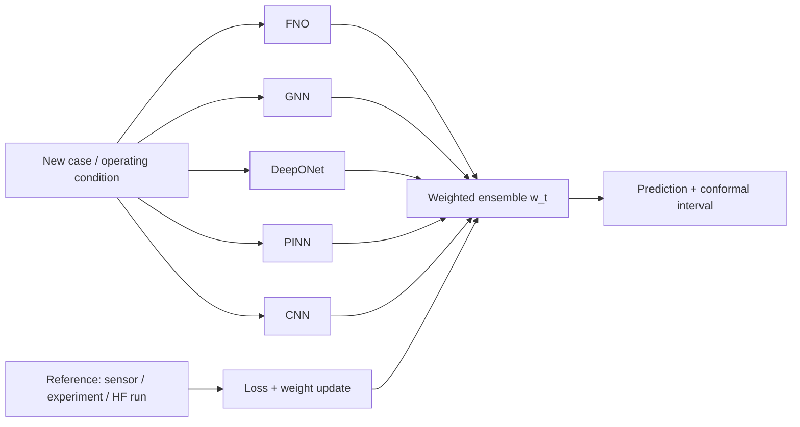

## 🎯 Relevance
Gives a practical, theoretically grounded way to deploy several mechanistic, hybrid or data-driven surrogates when operating regimes drift. This is the typical situation in a digital twin or soft sensor on an industrial process. Combining Fixed-Share and AdaHedge with adaptive conformal bands yields online model selection with calibrated uncertainty and no manual tuning, so it can be reused for process surrogates (e.g., wastewater, bioreactor, hydrometallurgy) where reference measurements arrive with a delay.

## 📖 Content
## Source
LinkedIn post by **Yan Barros** (Physics AI Lead Engineer, Scientific ML), seen via a Julien Sigüenza follow, about 1 day old. It describes an *adaptive ensemble* added to the **PINNeAPPle** library.

## Core claim
> "No single physics model wins everywhere. So stop picking one."

FNO, GNN, DeepONet, PINN and CNN each excel in some regimes and fail in others. Examples from the post:
- An **FNO** trained on low-diffusion flows reaches ~1% error there, but **40–130%** error when the regime changes.
- A **physics-only PINN** wins in diffusive regimes but struggles with advection.
- In real projects, regimes shift with operating conditions and it is rarely known in advance which model to trust.

## Proposed solution: online adaptive ensemble
The ensemble decides case by case:
1. Every model predicts each new case.
2. The ensemble selects or combines models based on their **track records so far**.
3. When the reference arrives (sensor, experiment or high-fidelity run), the weights are updated to improve the next prediction.



## Theory (online learning with expert advice)
1. **Prequential evaluation.** Each prediction uses only past data. This avoids validation-set tuning and reflects real deployment (test-then-train).
2. **Fixed-Share (Herbster & Warmuth, 1998).** Exponential weights
$$w_i \propto \exp\left(-\eta \cdot L_i\right),\quad L_i=\sum_{s<t}\ell_i(s)$$
plus a switching rate $\alpha$ that redistributes a fraction of the weight mass across experts. Unlike plain Hedge, which can lock onto yesterday's winner, Fixed-Share tracks *changing best-model sequences* with regret guarantees.
3. **AdaHedge (de Rooij et al., 2014).** Automatically selects the learning and switching rates over a grid of $(\eta,\alpha)$, with no manual tuning.
4. **Adaptive conformal intervals (Gibbs & Candès, 2021).** Model disagreement scales the uncertainty bands, which are recalibrated online to keep ~**90% coverage** as regimes drift.

## Fixed-Share update (sketch)
```python
import numpy as np

def fixed_share_step(w, losses, eta, alpha):
    # exponential-weights update
    v = w * np.exp(-eta * losses)
    v /= v.sum()
    # share step: redistribute alpha of the mass uniformly
    n = len(w)
    return (1 - alpha) * v + alpha / n

def predict(w, preds):
    return np.dot(w, preds)  # weighted combination
```

## Comparison
| Method | Handles regime switching | Tuning | Guarantee |
|---|---|---|---|
| Static best model (validation) | No | validation set | none under shift |
| Hedge | Poor (locks on past winner) | $\eta$ | static regret |
| Fixed-Share | Yes | $\eta,\alpha$ | tracking regret |
| AdaHedge + Fixed-Share | Yes | automatic grid | tracking regret, no manual tuning |
| Adaptive conformal | – | step size | ~90% long-run coverage |

## Practical notes
- Requires a feedback signal (reference) to arrive after prediction: sensors, lab analyses, or periodic HF simulation.
- Model disagreement (ensemble spread) is used as a proxy for uncertainty and as the scale for the conformal bands.
- The approach is model-agnostic: it works with any surrogate, mechanistic or data-driven.

## 💡 Key Insights
- No single surrogate (FNO, GNN, DeepONet, PINN, CNN) is best across regimes; an FNO can go from ~1% to 40–130% error under regime shift.
- An online ensemble weights models by their track record and updates the weights whenever a reference (sensor, experiment, HF run) arrives.
- Prequential evaluation avoids validation-set tuning and mimics real deployment.
- Fixed-Share adds a switching rate α to exponential weights, so it tracks changing best models, unlike Hedge, which can lock onto a past winner.
- AdaHedge removes manual tuning of η and α by selecting them automatically over a grid.
- Adaptive conformal inference (Gibbs & Candès) scales bands with model disagreement and recalibrates online to keep ~90% coverage under drift.
- Directly transferable to industrial soft sensors and digital twins, where operating conditions drift and the best model changes.

## 📚 References
- Yan Barros, LinkedIn post on the adaptive ensemble in PINNeAPPle (Physics AI Lead Engineer), ~1 day before capture *(source)*
- Herbster, M. & Warmuth, M. K. (1998). Tracking the best expert. Machine Learning. *(cited)*
- de Rooij, S., van Erven, T., Grünwald, P. D., Koolen, W. M. (2014). Follow the Leader If You Can, Hedge If You Must (AdaHedge). JMLR. *(cited)*
- Gibbs, I. & Candès, E. (2021). Adaptive Conformal Inference Under Distribution Shift. NeurIPS. *(cited)*

## 🏷️ Classification
The post presents an online ensemble of physics-informed and neural-operator surrogates (PINN, FNO, DeepONet) with uncertainty quantification, which falls under scientific/hybrid ML.
