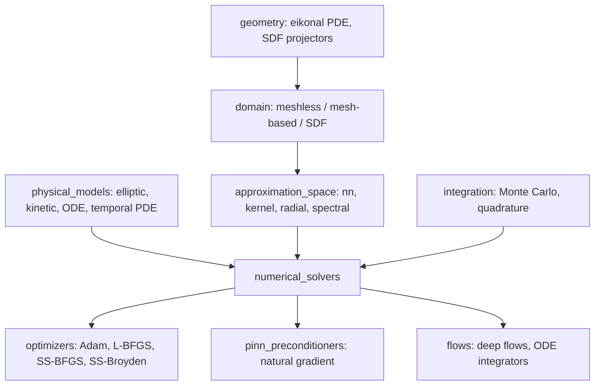

## 🎯 Relevance
Scimba is a ready-to-use open-source toolbox for prototyping PINN, Deep Ritz and neural-Galerkin surrogates of PDE-based process models, such as transport, reaction-diffusion and CFD-like problems. Its coverage of natural-gradient preconditioners and hybrid least-squares addresses PINN training instabilities, and its PyTorch and JAX backends let it plug into differentiable pipelines. It is a good learning resource and benchmark base for hybrid SciML work.

## 📖 Content
# Scimba 1.4.0 documentation: overview

Scimba is an open-source Python library (GitLab, Sphinx docs with the Furo theme) that implements **Scientific Machine Learning (SciML)** methods for **PDE problems**, along with tools for **hybrid numerical methods**. The page captured here is the documentation landing page and its navigation tree. It contains no numerical results, only architecture and feature descriptions.

## Scope

The current version solves **parametric PDE problems** using nonlinear approximation families combined with classical linear solvers (DG, FEM):

- Nonlinear approximators: neural networks, low-rank approximations, kernel-based methods.
- Complex geometries built with level-set techniques and mappings, including sub-volumetric and surface domains.
- Problem classes: function projections, elliptic PDEs, time-dependent PDEs and kinetic parametric PDEs.
- Space-time algorithms: PINN, Deep Ritz.
- Time-sequential algorithms: discrete PINNs, neural Galerkin, neural semi-Lagrangian schemes.

## Optimization strategies

- First-order and quasi-Newton optimizers: Adam, L-BFGS, SS-BFGS, SS-Broyden.
- **Natural gradient** methods for neural-network models, with several preconditioners (anagram, energy, Nyström, sketchy).
- Hybrid least-squares approaches.

A PINN with a loss over the PDE residual and boundary conditions can be written as:

$$\mathcal{L}(\theta)=\frac{1}{N_r}\sum_i \|\mathcal{N}[u_\theta](x_i,\mu_i)\|^2+\lambda_b\frac{1}{N_b}\sum_j\|\mathcal{B}[u_\theta](x_j,\mu_j)-g\|^2$$

where $\mu$ denotes the PDE parameters. This formula illustrates the method family and is not quoted from the page. Natural-gradient preconditioning replaces the Euclidean update $\theta\leftarrow\theta-\eta\nabla\mathcal{L}$ with $\theta\leftarrow\theta-\eta\,G(\theta)^{-1}\nabla\mathcal{L}$, where $G$ is a Gram or metric matrix.

## Two backends

| Package | Backend |
|---|---|
| `scimba_torch` | PyTorch |
| `scimba_jax` | JAX |

## Architecture of `scimba_torch` (from the API tree)



Modules:

- `approximation_space`: abstract, kernelx, nn, radial and spectral spaces.
- `domain`: mesh-based (cuboid), meshless (1D, 2D, 3D, nD) and SDF domains.
- `neural_nets`: MLP, discontinuous MLP, ResNet, SIREN, PirateNet, periodic embeddings, and structure-preserving nets (symplectic, coupling and invertible layers).
- `numerical_solvers`: elliptic PDE (Deep Ritz, PINNs), ODE PINNs, temporal PDE (discrete PINN, neural Galerkin, neural semi-Lagrangian, time-discrete), collocation projector.
- `physical_models`: Laplacians, advection-diffusion, Vlasov, radiative transfer, rigid body, damped oscillator, heat and transport equations.
- `geometry`: regularized eikonal PDE and SDF projectors for learning signed distance functions.

## Tutorials and examples

- Tutorials: 2D Laplacian, natural-gradient preconditioners, meshless domains, defining a physical model, function projection, saving and loading, strong and mixed boundary conditions, time-discrete schemes, optimizers, losses.
- Examples: Deep Ritz, viscous Burgers 1D, inhomogeneous Helmholtz, linearized Euler, grad-div system, **Navier-Stokes 2D**, pendulum flow, kinetic Vlasov 1D, rotating transport, implicit heat equation, 3D cylinder transport, 3D level-set advection, SDF learning.
- A companion course on PINNs is linked (`fabrique-ton-pinns`, Inria GitLab pages).

## Installation

```bash
uv init
uv add scimba
# or
uv pip install scimba
# or
pip install scimba
# AMD GPU (ROCm 6.4)
export UV_EXTRA_INDEX_URL="https://download.pytorch.org/whl/rocm6.4"
```

The docs recommend `uv` and an isolated virtual environment. The project also publishes a development guide covering setup, coding conventions, documentation, testing and benchmarks, plus CI badges (pipeline status, coverage, release).

## 💡 Key Insights
- Scimba combines nonlinear approximators (NNs, low-rank, kernels) with classical linear solvers (DG, FEM) for parametric PDEs.
- It supports both space-time methods (PINN, Deep Ritz) and time-sequential methods (discrete PINN, neural Galerkin, neural semi-Lagrangian).
- Natural-gradient preconditioners (anagram, energy, Nyström, sketchy) and quasi-Newton optimizers (SS-BFGS, SS-Broyden) target the known training difficulties of PINNs.
- Level-set and SDF-based geometry handling covers complex, surface and sub-volumetric domains without meshing.
- Two backends are offered, PyTorch (`scimba_torch`) and JAX (`scimba_jax`), with tutorials for strong and mixed boundary conditions, save/load and custom physical models.
- The tutorial and example set (Navier-Stokes, Vlasov, transport, heat) can serve as templates for PINN-based surrogates of process transport PDEs.

## 📚 References
- Scimba 1.4.0 documentation, https://www.scimba.org/docs/index.html *(source)*
- Scimba code repository, https://gitlab.com/scimba/scimba/ *(cited)*
- Course 'Fabrique ton PINNs', https://rimbach.gitlabpages.inria.fr/fabrique-ton-pinns *(cited)*

## 🏷️ Classification
The page documents a SciML library centred on PINNs, Deep Ritz and neural-Galerkin PDE solvers, which falls under hybrid modeling and SciML.
