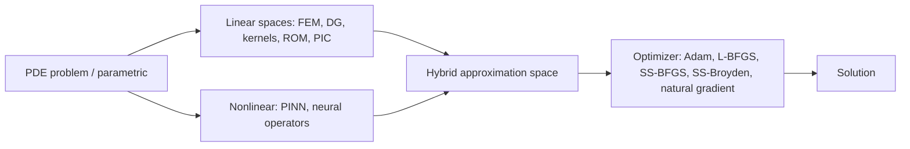

## 🎯 Relevance
Useful as a tool to watch for hybrid PDE modeling (mechanistic discretization plus neural correction) in process engineering, e.g. reaction-transport or reduced-order models for digital twins. The open-source PyTorch/JAX stack allows fast prototyping of PINN and hybrid ROM workflows.

## 📖 Content
## Overview

Scimba is an open-source Python library implementing **Scientific Machine Learning (SciML)** methods for partial differential equation (PDE) problems. It supports two backends, **PyTorch** (stable) and **JAX** (experimental). Its stated goal is to provide tools for **hybrid numerical methods**: composing classical linear approximation spaces with nonlinear neural approximations, so that high-dimensional simulations become more efficient and accurate.

Headline features listed on the page:
- Parametric PDEs
- Complex geometries via level-sets
- Natural-gradient optimizers
- PyTorch and JAX backends

## Method taxonomy

| Family | Component | Description |
|---|---|---|
| Nonlinear approximation | PINNs | Physics-informed networks trained directly on the PDE residual |
| Nonlinear approximation | Advanced optimizers | Adam, L-BFGS, SS-BFGS, SS-Broyden and natural-gradient methods |
| Nonlinear approximation | Neural operators | Operator-learning architectures for parametric solution maps |
| Linear approximation | DG / FEM | Discontinuous Galerkin and finite element spaces on meshes |
| Linear approximation | Kernel methods | RBF and kernel-based approximation spaces |
| Linear approximation | ROMs | Reduced-order models built from solution-manifold snapshots |
| Linear approximation | PIC / Lagrangian | Particle-in-cell and Lagrangian schemes for kinetic and transport problems |
| Hybrid | Hybrid approximation spaces | Network-based and classical linear spaces combined in the same least-squares training loop |
| Hybrid | Hybrid PIC | PIC schemes augmented with neural approximation |
| Hybrid | Hybrid ROMs | ROMs enriched with nonlinear manifold corrections |

## Conceptual framing

A generic hybrid approximation can be written as a sum of a linear (classical) part and a nonlinear (neural) part:

$$u_\theta(x;\mu) \approx \sum_{i=1}^{N} c_i(\mu)\,\phi_i(x) + \mathcal{N}_\theta(x;\mu)$$

where $\phi_i$ are classical basis functions (FEM, DG, RBF, POD modes), $\mathcal{N}_\theta$ is a neural network, and $\mu$ denotes the PDE parameters. Both parts are fit together by minimizing a least-squares residual loss:

$$\mathcal{L}(\theta,c)=\|\mathcal{R}[u_\theta]\|^2_{\Omega}+\|\mathcal{B}[u_\theta]-g\|^2_{\partial\Omega}$$

This formulation is an interpretation of the page's description ("combine network-based and classical linear spaces within the same least-squares training loop"); the page does not state the equations explicitly.

## Backends

- **Scimba Torch**: original PyTorch backend; stable and fully tested, but receives no new developments.
- **Scimba Jax**: experimental JAX rewrite with fast autodiff and vmapped classical solvers.

Documentation and code pages are available at scimba.org.

## Limitations of the source

The page is a landing page: it gives no benchmarks, API examples, equations or performance numbers. Details must be found in the linked documentation.

## 💡 Key Insights
- Scimba unifies classical discretizations (FEM, DG, kernels, ROM, PIC) and nonlinear SciML (PINN, neural operators) in one library.
- Its distinctive aim is hybrid approximation spaces: network-based and linear spaces trained together in a single least-squares loop.
- Supports advanced optimizers for neural PDE solvers (L-BFGS, SS-BFGS, SS-Broyden, natural gradient), which are key to PINN convergence.
- Complex geometries are handled through level-set representations; parametric PDEs are first-class.
- PyTorch backend is stable but frozen; JAX backend is experimental but is where new development happens, with fast autodiff and vmapped solvers.

## 📚 References
- Scimba — Scientific Machine Learning for PDEs, https://www.scimba.org/ *(source)*

## 🏷️ Classification
The page presents a SciML library for PDEs that hybridizes classical numerical methods with PINNs and neural operators, which is the core of hybrid scientific ML.
