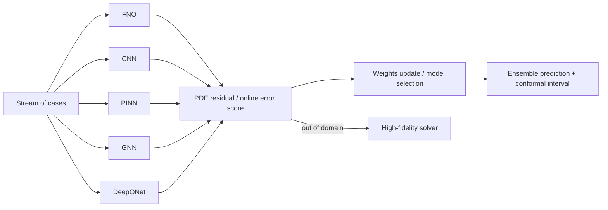

## 🎯 Relevance
Useful for industrial digital twins and surrogate-based simulation: it shows how to combine heterogeneous surrogates (neural operators, PINNs, GNNs) with residual-based monitoring, calibrated uncertainty and cost-aware fallback to high-fidelity solvers, addressing the regime-shift robustness problem of single-surrogate deployments. The approach is transferable to process/CFD surrogate deployment, though validation so far is limited to a 1-D toy benchmark.

## 📖 Content
## Overview

This LinkedIn post (screenshot of a mobile feed, hashtags including #PINNeAPPle) presents an **adaptive ensemble** that selects among several scientific-ML surrogate families online, as the operating regime of a PDE-governed system changes. The ensemble is evaluated on a controlled 1-D advection-diffusion benchmark with exact solutions. The same core also supports ground-truth-free monitoring and cost-aware execution.

## Core capabilities (as stated)

- **Ground-truth-free monitoring**: PDE residuals flag when a model is operating outside its validity domain.
- **Cost-aware execution**: use cheap surrogates when adequate, fall back to high-fidelity solvers otherwise.
- **Uncertainty quantification**: prediction intervals (hashtag #ConformalPrediction) with 90% nominal coverage.

## Benchmark protocol ("exact solutions, no hidden ground truth")

- 1-D advection-diffusion PDE: $\partial_t u + c\,\partial_x u = \nu\,\partial_{xx} u$ across **five regimes**.
- Each model family is **trained on a single regime**; the test stream **traverses all five**.
- Metric: mean relative $L^2$ error, $\|u_\theta - u\|_2 / \|u\|_2$.

## Results

| Configuration | Mean rel. L2 error |
|---|---|
| Best single model (across the whole stream) | 24 % |
| **Adaptive ensemble** | **7.8 %** |

Best family **within its own regime**:

| Family | Error in own regime |
|---|---|
| CNN | 0.96 % |
| FNO (Fourier Neural Operator) | 1.2 % |
| PINN | 4.2 % |
| GNN | 5.4 % |
| DeepONet | 11 % |

- 90 % prediction intervals covered **90 %** of the points (well-calibrated coverage).

## Visualization (GIF)

- Black line = exact field; dashed line = ensemble prediction, coloured by the selected model, with its uncertainty band.
- A bar chart of **weights** shows the shift between model families as regimes change (example frame: case 1/80, t=0.65, chosen FNO, error 1.54%).

## Mechanism (conceptual)

The selection is driven by ground-truth-free signals (PDE residuals) and online learning of weights; conformal prediction wraps the output to give calibrated intervals.

## Limits (as stated by the author)

- Switching takes **2–6 cases** after abrupt regime changes.
- Performance **cannot exceed the best provided model**: it *selects*, not extrapolates.
- Controlled **1-D benchmark** only; next step is real-world **CFD fields**.

## Reproducibility

One script, ~4 min on laptop CPU (code and docs linked via lnkd.in shortlinks). Closing question to the audience: one model per project, fixed average, or adaptive approach?

## 💡 Key Insights
- Adaptive online selection among surrogate families cut mean relative L2 error from 24% (best single model) to 7.8% on a regime-switching stream.
- Each architecture dominates only in its own regime (CNN 0.96%, FNO 1.2%, PINN 4.2%, GNN 5.4%, DeepONet 11%), so no single surrogate is robust to regime shifts.
- PDE residuals provide a ground-truth-free signal to detect out-of-domain operation and drive model selection/fallback to high-fidelity solvers.
- Conformal prediction gives calibrated uncertainty: 90% intervals covered 90% of points.
- Limitations: 2–6 case switching lag, no extrapolation beyond the model pool, only validated on a 1-D benchmark (CFD planned).

## 📚 References
- LinkedIn post on adaptive ensemble of physics-AI surrogates (FNO, GNN, DeepONet, PINN, CNN) with conformal prediction, #PINNeAPPle; code and docs via lnkd.in shortlinks (g_w2sMWP, gc8-FyyX) *(source)*

## 🏷️ Classification
The post concerns combining PINN, FNO, DeepONet and other scientific-ML surrogates in a multi-model adaptive ensemble with PDE-residual monitoring and uncertainty, which is hybrid SciML.
