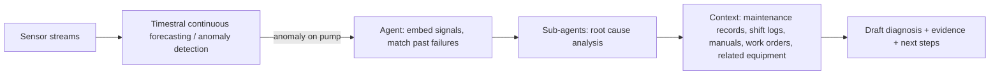

## 🎯 Relevance
Time-series foundation models enable zero-shot, probabilistic, covariate-aware forecasting of process sensors with little site-specific data. CPU-only inference and air-gapped deployment suit OT environments. They are useful for virtual sensors, anomaly detection against production schedules and risk-based predictive maintenance, so they are worth benchmarking against in-house mechanistic and ML baselines on plant data. The vendor-reported results and the pending technical report call for in-domain backtesting before adoption.

## 📖 Content
## Overview

Timestral is Mistral's first family of **time-series foundation models (TSFM)**. It comes in four sizes (5M, 28M, 123M and 209M parameters) that share one architecture and one training recipe. The announcement dated 2026-07-15 claims that the 209M model ranks first among pre-trained zero-shot models on three public forecasting benchmarks: **GIFT-Eval**, **TIME** and **fev-bench**. It reports this from a single checkpoint, without ensembling, and with about two-thirds of the parameters of the previous state of the art. The technical report is not yet published, so the architectural details below are only what the announcement states.

## Why time-series foundation models

| Approach | Characteristics | Limitation |
|---|---|---|
| ARIMA, linear regression | Fitted per series, learn only from that series' history | No cross-series transfer |
| Deep learning (e.g. PatchTST) | Learns nonlinear patterns across many related series | Trained from scratch per dataset, no transfer to new domains |
| TSFM (Timestral) | Pre-trained on a large, diverse corpus | Needs domain adaptation if the distribution shifts |

A TSFM can forecast zero-shot on data it has never seen, including in domains where data is scarce.

## Model specification

| Item | Value |
|---|---|
| Type | Time-series foundation model |
| Parameters | 5M, 28M, 123M, 209M |
| Context length | 32,768 time steps |
| Output | Probabilistic forecast, 21 quantiles |
| Inputs | Multivariate targets, past-only covariates, known-future covariates, categorical covariates |
| Deployment | On-prem, VPC, air-gapped |
| Licence | Modified MIT |

## Benchmarks and Pareto efficiency

- The model ranks first across all five metrics on GIFT-Eval (83 comparable entries), TIME (35 entries) and fev-bench (37 entries, SQL skill score).
- Every size sits on the Pareto front of accuracy versus model size.
- The 28M model beats Chronos-2, which is about 4x larger, on GIFT-Eval and TIME.
- The 209M model beats TimesFM-3 and Falcon-2.0 with fewer parameters.

### CPU inference

No GPU is needed. The measurements are for one day ahead from three weeks of 15-minute history, on a server CPU with 8 threads.

| Model | Latency |
|---|---|
| 5M | 10 ms |
| 28M | about 5x faster than 209M |
| 123M | 0.2% score loss vs 209M, 75% of its latency |
| 209M | 140 ms |

## Key technical contributions

1. **Decoupled Horizon Forecasting (DHF).** In causal decoders trained with contiguous patch masking (Toto 2.0, TimesFM-3), the values to forecast are masked. They then look like missing values and are lost as context for later forecasts. DHF keeps the full history in the sequence, and learned *forecast tokens* read the history before them. Every observed value is both target and context, true gaps stay flagged as missing, and training horizon lengths and missing-data augmentation can be tuned independently.
2. **Covariate-aware attention.** Each series has a role: target, past-only covariate or known-future covariate. Known-future covariates are visible over the whole window, targets stay causal, and information flows only from covariates to targets. This prevents leakage of a target's own future.
3. **Synthetic-first data.** Most training data is synthetic. Univariate processes with trends, seasonality and diverse noise are generated first. A multivariate synthesizer then adds nonlinear dependencies between them.
4. **Two-stage training.**
   - Stage 1: pre-training on purely synthetic data with context 8192.
   - Stage 2: post-training on real and synthetic data with a 4x longer context (32,768).
   - The objective is the pinball (quantile) loss over 21 quantiles, a discrete approximation of CRPS:

$$\mathcal{L}=\frac{1}{K}\sum_{k=1}^{K}\sum_t \max\big(\tau_k (y_t-\hat q_{t,k}),\,(\tau_k-1)(y_t-\hat q_{t,k})\big),\quad K=21$$

```text
[history tokens ........][forecast tokens (learned)]
  observed values = target AND context      -> read the history before them
  covariates -> targets (one-way attention); known-future covariates visible over the full window
```

## Industrial use case

- **Multivariate**: vibration, temperature and pressure of a pump are modelled jointly rather than as isolated sensors.
- **Probabilistic**: quantiles let teams set alert thresholds that reflect the uncertainty and plan maintenance around risk.
- **Categorical covariates**: day of week or machine state (running, idle, maintenance) are used directly, without imposing a numeric order.
- **Known-future covariates**: production schedules, planned shutdowns and weather forecasts are used as inputs, so a scheduled load increase is expected rather than flagged as an anomaly.

### Agentic workflow (model to system)



## Adaptation via Mistral Forge

Production data drifts through regime change, equipment degradation and demand shifts. Forge, the same training pipeline Mistral uses for its LLMs, supports:

- zero-shot inference;
- architectural extensions (domain-specific covariates);
- fine-tuning on proprietary data while preserving general performance;
- control of the training mix, replay of pre-training data and synthetic data generation. This ensures that nothing backtested was seen in pre-training.

The full pipeline can be deployed on client hardware, including air-gapped environments. A GitHub repository (mistralai/timestral) is available, and the technical report will follow.

## Caveats

- The results are self-reported, and the leaderboards are only a general proxy for performance.
- Details of DHF, the synthesizer and the training recipe await the technical report.
- Sensor-specific performance (noisy, irregular or non-stationary industrial data) must be validated on in-domain backtests.

## 💡 Key Insights
- Timestral (5M–209M) claims first place among pre-trained zero-shot models on GIFT-Eval, TIME and fev-bench with a single checkpoint and no ensembling.
- Every size lies on the accuracy-vs-size Pareto front; the 28M model beats the roughly 4x larger Chronos-2 on GIFT-Eval and TIME.
- CPU-only inference is practical: 10 ms (5M) to 140 ms (209M) for a 1-day horizon from 3 weeks of 15-min data, which suits edge and on-prem industrial deployment.
- Decoupled Horizon Forecasting keeps the full history as context and uses learned forecast tokens, avoiding the masked-values-as-missing problem of patch-masked causal decoders.
- Covariate-aware attention with roles (target, past-only, known-future) and one-way covariate-to-target information flow prevents target leakage while using schedules and weather forecasts.
- Training is mostly synthetic (trends, seasonality, noise, nonlinear multivariate coupling), in two stages (context 8192 then 32,768) with a 21-quantile pinball loss, an approximation of CRPS.
- Quantile outputs and categorical covariates (machine state, weekday) map directly onto risk-based maintenance and alerting in plants.
- Fine-tuning and data-control options (Forge, air-gapped deployment) address drift and backtest-leakage concerns, but the results are vendor-reported and the technical report is still pending.

## 📚 References
- Mistral AI, 'Timestral: Mistral's First Family of Time-Series Foundation Models', https://mistral.ai/news/timestral/, 2026-07-15 *(source)*
- GitHub repository: https://github.com/mistralai/timestral *(source)*
- GIFT-Eval benchmark (general time series forecasting model evaluation) *(cited)*
- TIME benchmark leaderboard *(cited)*
- fev-bench (forecasting evaluation benchmark) *(cited)*
- Chronos-2, TimesFM-3, Toto 2.0, Falcon-2.0 (competing time-series foundation models) *(cited)*
- PatchTST (patch-based Transformer for time series forecasting) *(cited)*

## 🏷️ Classification
The article announces a time-series foundation model for probabilistic multivariate forecasting with covariates, applied to industrial sensor data, which falls under ML on industrial data.
