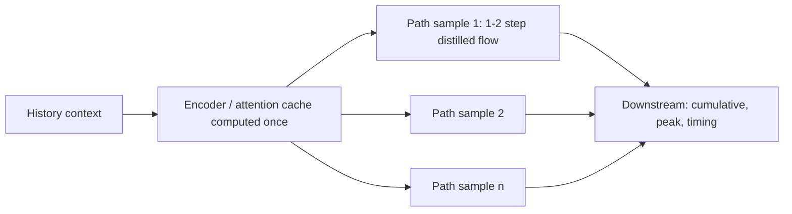

## 🎯 Relevance
Useful for industrial forecasting where scenario consistency matters (energy/load peaks, cumulative consumption, event timing such as threshold crossings in process signals). Sampled coherent trajectories enable risk-aware decision support and Monte Carlo scenario analysis at low inference cost, and the path-aware scoring (energy/variogram) is a good practice for benchmarking time series foundation models on industrial data.

## 📖 Content
## Overview

PathFM (arXiv:2610.22358, cs.LG) is a **time series foundation model** that generates *complete future trajectories* instead of marginal quantiles. The abstract-level source gives the motivation, the main technical ingredients and the evaluation claims. No equations, architecture details or numerical results are available from the page beyond the abstract, so only what is stated there is reported here.

## Problem addressed

Most leading time series foundation models predict **marginal quantiles** per horizon step. This leaves the **temporal dependence structure** of the future trajectory unspecified. That matters for path-dependent quantities such as:

- cumulative demand (sum over horizon)
- peak load (max over horizon)
- event timing (first-passage / threshold crossing)

Point metrics and marginal scores (e.g. quantile loss, CRPS per step) cannot reveal whether the joint dependence is realistic.

## Method (as described in the abstract)

| Component | Role |
|---|---|
| Flow matching generative model | Generates full future paths conditioned on history |
| Distillation to 1-2 steps | Removes the many-step ODE integration cost of flow sampling |
| Shared history attention cache across draws | History is encoded once and reused for every sampled path |
| Calibration loss optimized directly | Made practical by the fast distilled sampler (differentiable through few steps) |

The net effect claimed: drawing **multiple paths for one series costs roughly one query to a quantile model**.

### Background: flow matching

Flow matching learns a velocity field $v_\theta(x_t, t \mid \text{history})$ whose ODE $\frac{dx_t}{dt}=v_\theta(x_t,t)$ transports noise to the data distribution of future paths. Distillation compresses this integration into 1-2 steps. (General background, not detailed in the source page.)

## Evaluation

- **Marginal accuracy**: competitive on established benchmarks **fev-bench** and **TIME**.
- **fps-bench (Forecast Path Score Bench)**: new benchmark that augments fev-bench tasks with **energy score** and **variogram score** (multivariate/path-aware proper scoring rules) plus downstream metrics. PathFM achieves a higher aggregate path score than all evaluated external baselines.
- **Chaotic systems**: the flow model sustains long-run variability, whereas strong baselines rapidly collapse (to mean-like/low-variance forecasts).

### Scoring rules reminder

Energy score for forecast distribution $F$ and observation $y$: $$ES(F,y)=\mathbb{E}\|X-y\|-\tfrac12\mathbb{E}\|X-X'\|$$ A proper multivariate score sensitive to dependence structure; the variogram score focuses on pairwise differences between components/time steps.

## Limitations of this card

Only the abstract page was available: no architecture, training data, hyperparameters or numerical results are reported here.

## 💡 Key Insights
- Marginal-quantile foundation models leave trajectory dependence unspecified, which hurts path-dependent quantities (cumulative demand, peak, event timing).
- PathFM uses flow matching to generate full multivariate future paths rather than per-step quantiles.
- Distillation to 1-2 steps plus a shared history attention cache makes multi-path sampling cost about one quantile-model query.
- The fast sampler makes direct optimization of a calibration loss practical.
- fps-bench adds energy and variogram scores to fev-bench tasks to evaluate joint path quality; PathFM leads the aggregate path score among external baselines.
- On chaotic systems, baselines collapse in variability while the flow model sustains long-run variability.

## 📚 References
- PathFM: Fast Generative Forecasting of Multivariate Trajectories, arXiv:2610.22358 [cs.LG], v1, 15 Oct 2026. https://arxiv.org/abs/2610.22358 *(source)*
- fev-bench (forecasting benchmark) — referenced in the abstract *(cited)*
- TIME benchmark — referenced in the abstract *(cited)*

## 🏷️ Classification
The paper presents a time series foundation model for generative trajectory forecasting, which falls under ML on industrial time series and foundation models.
