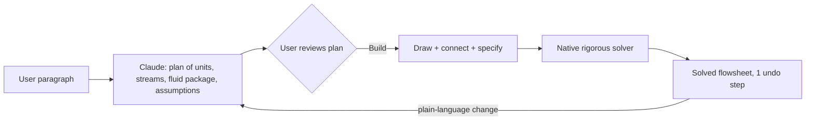

## 🎯 Relevance
Shows a concrete, working example of LLM-assisted (agentic) process flowsheet generation coupled to a rigorous solver, and how to keep AI out of the numerical loop. It is useful for competitive watch on AI-augmented simulators (HYSYS, Aspen, DWSIM) and as a design reference for LLM copilots in process-engineering and digital-twin tooling.

## 📖 Content
## Overview

The page presents **AI Process Simulator v1.6.1**, a desktop steady-state process simulator (Windows 10/11 64-bit, macOS 13+). Its main feature is **Build with AI**: the user describes a process in plain language, Anthropic's Claude plans the streams and units, and on pressing *Build* the flowsheet is drawn, connected and solved by the simulator's own solver.

## Key design principle: the LLM plans, the solver computes

* The plan is shown before anything changes (summary, assumptions, fluid package, every stream and unit).
* **Every number comes from the simulator's solver, never from the AI.** The LLM does no thermodynamics.
* The whole Build is a single undo step (Ctrl+Z). Requests and plans are stored in the case's build history.
* Uses the user's own Anthropic API key; about 5–12 US cents per five-to-ten-unit flowsheet (vendor tests).

### Demonstration
A gas-conditioning plant paragraph became a plan with 5 units and 9 streams, with a recycle through a gas/gas exchanger. Peng-Robinson with 10 components. Build and solve took 10.3 s, giving 9,478 kg/h NGL at -20 °C. A plain-language edit ("lower the chiller outlet to -30 C") changed one unit and the recycle tear-stream estimate, and NGL rose to 12,537 kg/h.

## AI convergence advisor
When a distillation column fails to converge, Claude reads the solver's diagnostics and can run test solves on a **private copy** of the case. It proposes changes but does not apply them autonomously.

## Simulation capabilities

| Area | Content |
|---|---|
| Unit operations | 25 units and logical blocks: rigorous columns (full MESH equations), absorbers/strippers, Gibbs, equilibrium, conversion, PFR and CSTR reactors, exchangers, pumps, compressors, pipes, Adjust/Spec controllers, recycles, nested sub-flowsheets |
| Thermodynamics | PR, PRSV, SRK EOS; NRTL; UNIFAC (VLE, LLE, NIST revision); Ideal; Incompressible; COSTALD liquid density; editable interaction parameters |
| Components | 362 pure components plus crude-oil pseudo-components (assay characterization) |
| Reporting | Live PFD worksheet linked to the model, equipment datasheets, Excel/PDF export, live stream tables |
| Interoperability | Imports Aspen HYSYS (XML, older .hsc), DWSIM, COCO/COFE; *Validate import* compares T, P, flow, composition, vapour fraction per stream with the source simulator |

Reactors minimise Gibbs energy, hold chemical equilibrium or integrate rate laws along the length (PFR). Flowsheets solve automatically in the right order as soon as inputs are complete.

## Manual workflow (six steps)
1. Place equipment from the palette
2. Connect streams to ports
3. Specify each unit (e.g. cooler outlet -15 °C, 0.5 bar ΔP)
4. Describe the feed (fluid package, composition)
5. Automatic solve (units turn green)
6. Report with a live stream table

## Validation (1,109 checks)

| Strength of evidence | Checks | Result |
|---|---|---|
| Analytic (closed-form, closing balances) | 281 | PASS |
| Published reference data (NIST, IAPWS-IF97, NASA-7) | 116 | PASS |
| Experimental unit-operation data | — | NOT RUN |
| Third-party simulator comparison | 146 | PASS |

The vendor states explicitly that nothing is yet validated against measurements from real equipment, and that agreement with another simulator is not proof of correctness. (The listed categories sum to fewer than 1,109, so other categories exist in the full report.)

## Licensing and limits
Version 1.6.1 is free; later releases are priced on request. No Linux version. Newer encrypted HYSYS .hsc files cannot be read directly; the XML route is required.

## Assessment
The architecture follows a sound pattern for LLM use in engineering: constrained structured planning, human approval gate, deterministic numerical engine, auditability and undo. It is a steady-state tool: no dynamics, no plant data integration.

## 💡 Key Insights
- Safe LLM pattern for engineering software: the LLM produces a reviewable plan, a deterministic solver produces every number, so hallucinated values cannot reach results.
- A human approval gate (plan shown, nothing changes until Build) plus single-step undo and stored build history gives auditability.
- Plain-language edits modify only the affected units and tear-stream initial estimates, enabling conversational what-if studies (chiller -20 to -30 °C: NGL 9,478 to 12,537 kg/h).
- The convergence advisor reads solver evidence and runs test solves on a private case copy, a useful model for agentic debugging of column convergence.
- Validation is stratified by evidence strength (analytic, reference data, cross-simulator), and the vendor admits no real-equipment validation; this is an honest framing worth copying.
- Import and cross-check of HYSYS/DWSIM/COCO cases lowers switching cost and allows benchmarking against incumbents.
- Low API cost (about 5–12 US cents per flowsheet) makes LLM-assisted flowsheet drafting economically trivial.

## 📚 References
- Therqon, "AI Process Simulator - describe a process, build a solved flowsheet", v1.6.1, https://therqon.ca/ *(source)*
- Therqon, Build with AI documentation, https://therqon.ca/build-with-ai/ *(cited)*
- Therqon, Validation report, https://therqon.ca/validation/ *(cited)*

## 🏷️ Classification
Product web page for a steady-state process simulator whose core novelty is an LLM front end that plans flowsheets solved by a rigorous native solver, so the main subject is process simulation tooling.
